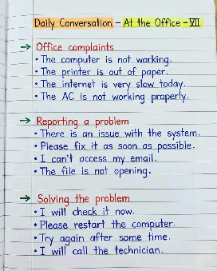
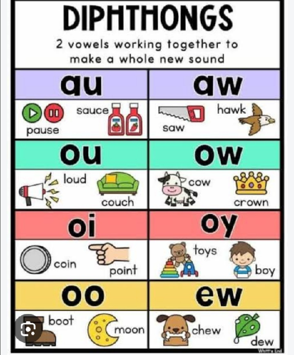
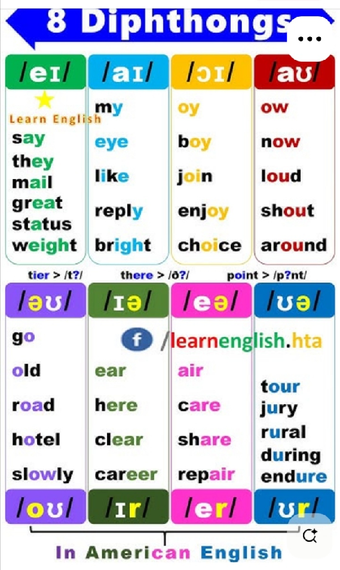
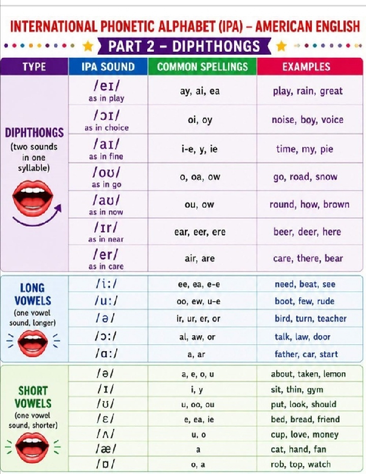
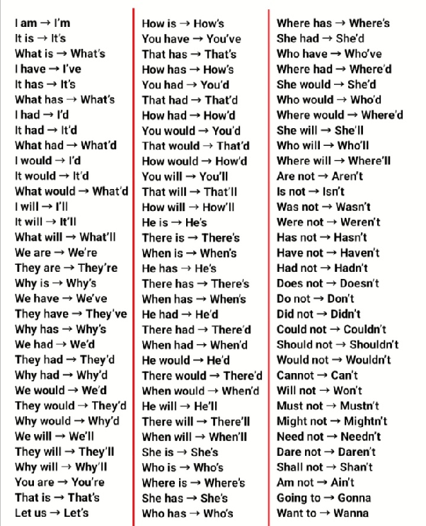

# Lesson 02 — Office Problems & Pronunciation

**Privacy note:** Personal and third-party details have been removed or generalised. First-person stories and altered quotations are anonymised study examples, not a biographical record or verbatim transcript.

> **Focus:** Reporting office problems, responding professionally, and understanding connected speech.  
> **Editorial note:** Repeated summaries have been combined. Model answers, dialogues, clarifications, and review exercises are study aids, not verbatim classroom quotations or confirmed teacher assignments.

## 1. Lesson Overview

**Class context:** The opening conversation introduced **business English and office complaints**.

**Main communication goal:** Move from **describing a problem** to **suggesting an action** and **confirming the next step**.

| Priority | Focus | Target skill |
| --- | --- | --- |
| **High** | Fault descriptions and responses | Describe a problem and respond with a **clear action**. |
| **High** | Basic grammar | Use **is/are, articles, plural nouns, and third-person singular verbs** consistently. |
| **High** | Can/can't | Recognize **affirmative and negative meaning** in context and ask for confirmation. |
| **Supporting** | Contractions and connected speech | Understand common forms without sacrificing **clarity**. |

## 2. Core Workplace Expressions

### A. Reporting Problems

| Situation | Classroom expression | Reusable pattern |
| --- | --- | --- |
| Computer failure | The computer **is not working**. | **Device + is not working** |
| No printer paper | The printer **is out of paper**. | **Be out of + supply** |
| Slow connection | The internet **is very slow today**. | **The internet + is + description** |
| System problem | There is **an issue with the system**. | **An issue with + object/system** |
| Email access | I **can't access my email**. | **Can't access + object**; no to after the verb access |
| File problem | The file **is not opening**. | **Singular subject + is + -ing** |
| Air-conditioning problem | The AC **is not working properly**. | **Not working properly** means not functioning correctly. |

**Vocabulary clarification:** In this context, **AC** usually refers to **air conditioning** or an **air conditioner**; the original notes' expansion “Air Condition” should not be memorized as the standard noun phrase.

**Tone clarification:** Both **issue** and **problem** are normal workplace words; issue can sometimes sound less direct, but problem is not inherently unprofessional.

### B. Responding to Problems

| Purpose | Classroom expression | Learning point |
| --- | --- | --- |
| Check immediately | I **will check it now**. | **Will + base verb** for the action offered |
| Suggest a restart | Please **restart the computer**. | **Please + base verb** for a polite request |
| Suggest waiting | **Try again after some time**. | A more specific alternative is **Please try again in a few minutes**. |
| Contact support | I **will call a technician**. | **A technician** is a singular countable noun phrase. |

**Additional model:** Please **try again in a few minutes**.

**Practical point:** Give a specific waiting time only when you have **a reasonable basis for it**.

### C. Practice Dialogues — Added Examples

#### Computer Problem

**The learner:** The computer **is not working**.  
**Colleague:** Please **restart the computer**.  
**The learner:** I've restarted it, but it **still isn't working**.  
**Colleague:** I **will call a technician**.

#### Email Access

**The learner:** I **can't access my email**.  
**Colleague:** I **will check it now**.  
**Colleague:** There is **an issue with the system**.  
**The learner:** Please **let me know when it's fixed**.

**Speaking framework:** **Problem → action already tried → next step**.

## 3. Pronunciation & Listening Difficulties

> **Editorial clarification:** Some pronunciation statements in the original notes were too absolute; the explanations below distinguish **common speech patterns** from rules that apply in every accent or situation.

### A. Can vs. Can't

| Feature | Can | Can't |
| --- | --- | --- |
| Common pronunciation | Often **/kən/** when unstressed; **/kæn/** when stressed | Commonly **/kænt/** in American English and **/kɑːnt/** in British English, with accent variation |
| Stress | Often unstressed in affirmative sentences, but can be emphasized | Often carries important negative information and may be prominent |
| Final sound | Ends in **/n/** | The **/t/** may be released, unreleased, or realized differently depending on accent and context |
| Listening strategy | Use **meaning and sentence stress** | Combine **context, stress, vowel quality, and final consonant cues** |

**Contrast practice:**

> I **can** access my email.  
> I **can't** access my email.

**Important correction:** Do not rely only on **vowel length**, and do not interpret an unreleased /t/ as a rule that **the /t/ in can't must always be omitted**.

**Clarification question — added example:**

> Did you say you **can** access it or you **can't**?

### B. Two Contractions of Is Not

| Full form | Contracted form | Explanation |
| --- | --- | --- |
| The file **is not opening**. | The **file's not opening**. | Here, **file's = file is**, not a possessive. |
| The file **is not opening**. | The file **isn't opening**. | **Isn't = is not**. |
| The files **are not opening**. | The files **aren't opening**. | Plural **files** takes **are/aren't**. |

**Key distinction:** A **contraction** changes the form of words; an unreleased or weakened final /t/ is a **pronunciation phenomenon**, not the same rule.

### C. Practising a Complete Phrase

**Classroom sentence:**

> The **AC** is **not working properly**.

**Suggested practice sequence:**

1. **Start clearly:** Make every word understandable at a comfortable speed.
2. **Connect naturally:** Reduce unnecessary pauses between **AC** and **is**.
3. **Highlight the message:** Stress **AC** or **not working properly**, depending on what you need to communicate.
4. **Try a contraction:** The AC **isn't working properly**.

**Teacher feedback:** The notes report that the learner's basic pronunciation was good, while she needed more familiarity with **connected speech and natural speaking speed**.

**Practice principle:** Aim for **clear, natural, understandable speech** before increasing speed; do not force sound deletion or imitate a single accent as the only correct model.

## 4. Personal Conversation Topics

### A. Work & Translation Tools

**Class notes:** the learner mainly communicates through messages and email, occasionally receives overseas English calls, and described the team's reliance on **real-time speech-to-text translation**.

**Model answers:**

> We mainly **communicate through messages and email**.  
> We use **translation software** to help us communicate.  
> I sometimes **receive calls from people in other countries**.  
> I want to **rely less on translation tools**.

**Vocabulary focus:** **Translation software** or **a translation app** clearly identifies a tool; **translator** can also mean a person.

**Learning direction:** The teacher encouraged greater exposure to English and stronger **independent communication skills**, including for travel and informal conversations.

### B. Pets

**Class notes:** the learner keeps **pet birds** and feels that pets bring happiness and make life more lively.

**Model answers:**

> I have **pet birds**.  
> They **bring me joy** and **make my life more interesting**.

**Spelling focus:** **Peach-faced** has a hyphen; **lovebirds** is one word and is plural after two.

### C. Culture, Clothing & Geography

**Class notes:** the learner discussed traditional clothing, including a robe recorded as **Jalaba** and a **scarf**, and connected clothing differences with climate and the natural environment; she knew the locations of many African countries but had not visited African or Arab countries.

**Model answers:**

> I'm interested in **traditional clothing and different cultures**.  
> Clothing can be influenced by **the local climate and environment**.  
> I **haven't visited any African or Arab countries yet**.

**Vocabulary clarification:** “Jalaba” may refer to the North African robe commonly spelled **djellaba**, but the precise intended term cannot be confirmed from these notes alone.

## 5. Grammar Corrections & Expression Improvements

### A. Agreement, Plurals & Articles

| Recorded expression | Corrected expression | Rule |
| --- | --- | --- |
| two parrot | **two parrots** | Use a **plural countable noun** after two. |
| the files not work — a confused fragment in the notes | The **file is not opening**. / The **files are not opening**. | Match **file + is** and **files + are**; with work, use **The file doesn't work / The files don't work**. |
| Internet is very slow today. | **The internet** is very slow today. | Normally use **the internet**; this is not a countable-noun plural rule. |
| We use translator to communicate. | We use **a translator** to communicate. | A singular countable noun needs a determiner; **We use translation software** is clearer when software is intended. |
| We have translator. | We have **a translator**. | Use **a + singular countable noun**; **a translation app** may be more precise. |
| it translate | It **translates**. | Add **-s/-es** for a third-person singular subject in the simple present. |

### B. Sentence Structure & Natural Wording

| Recorded expression | Recommended expression | Explanation |
| --- | --- | --- |
| let the life alive | Pets **make my life more interesting**. | A model based on the pet context; use **make + object + adjective**. |
| Today is today is holiday. | Today is **a holiday**. | Remove the repetition and add an article; if it is simply a day without work, **I have the day off today** may fit better. |
| I I dont have to go to work | I **don't have to go to work**. | Standard writing uses **don't**; a repeated I is a fluency issue. |
| peach faced love birds | **peach-faced lovebirds** | Correct the **hyphen and compound-word spelling**. |

**Additional comparison:**

> Pets **make my life more interesting**.  
> My schedule **lets me spend more time with my pets**.

**Pattern distinction:** **Make + object + adjective** describes a resulting state; **let + object + base verb** means to allow something.

### C. Unclear Fragments: Rewrite According to Meaning

The fragments **“Culture in my country were other countries”** and **“As in culture. Asre.”** do not establish a clear intended meaning, so there is no single certain correction.

| Possible intended meaning | Model expression |
| --- | --- |
| Interest in several cultures | I'm **interested in the cultures of my own country and other countries**. |
| Asking about differences | **How does the culture of my country compare with that of other countries?** |
| Interest in ethnic cultures | I'm **interested in ethnic cultures**. |

**Comparison focus:** Compare **culture with culture**; in the second example, **that** refers to culture.

### D. Items That Should Not Be Classified as Grammar Errors

| Item in the original notes | Clarification |
| --- | --- |
| I **cannot always rely on a translator**. | **Grammatically correct**; useful for practising rely on. |
| I **specialize in a subject**. | **Grammatically correct**; the student was practising a supplied sentence pattern, so it does not establish her professional background. |
| I **use the internet for typing**… | The basic structure is correct; naturalness depends on the complete context. |
| “Itsa good day.” | May represent connected speech in **It's a good day**; the transcription alone does not prove that words were omitted. |
| “My day is is is all right.” | The original notes identify this as **the teacher's speech**, not a student error. |
| “I I…” and similar repetitions | Treat as **hesitation or self-correction**, separately from grammar. |

## 6. Follow-up & Review

### A. Recorded Follow-up

- **Pronunciation materials:** The teacher promised to send pronunciation rules by email; receipt is **not confirmed** in the notes.
- **Next lesson:** Continue with **other business English topics**.
- **Closing:** Both participants were satisfied with the conversation, and the learner had **no further questions at that point**.

### B. Daily 15-Minute Practice — Editorial Suggestion

| Time | Task | Success criterion |
| --- | --- | --- |
| **5 minutes** | Read problem descriptions and responses aloud. | Keep the **negative meaning** clear. |
| **5 minutes** | Play both roles in two workplace dialogues. | Complete **problem → attempted action → next step**. |
| **5 minutes** | Record a short answer about work, pets, or culture. | Check **agreement, articles, verb forms, and plurals**. |

### C. Complete the Sentences — Added Exercise

1. I have two ______. *(parrot)*
2. The file ______ not opening. *(is / are)*
3. The files ______ not opening. *(is / are)*
4. It ______ speech into text. *(convert)*
5. I can't ______ my email. *(access / access to)*
6. We use ______ translation app. *(a / an)*

**Answers:** 1. **parrots**; 2. **is**; 3. **are**; 4. **converts**; 5. **access**; 6. **a**.

### D. Speaking Tasks — Added Practice

- **Ask for help:** Describe a fault, explain what you have tried, and ask about the next step.
- **Discuss an interest:** Talk about pets or culture and give **one reason or example**.
- **Confirm meaning:** Use **Did you say you can access it or you can't?** when a key word is unclear.

### E. Review Checklist

- [ ] I can describe at least **five office problems**.
- [ ] I can give at least **three useful responses**.
- [ ] I distinguish **The file is…** from **The files are…**.
- [ ] I check **articles, noun plurals, and third-person singular verbs**.
- [ ] I do not rely on just one sound cue to identify **can/can't**.
- [ ] I can **ask for confirmation** when important information is unclear.
- [ ] I use **brief pauses** instead of repeatedly restarting a sentence.
- [ ] I have checked the **email address** and whether the pronunciation materials arrived.

## 7. Original Images

**Source note:** All five images are preserved in their original order; text inside the images is unchanged, so read them alongside the **editorial clarifications** above.

### Image 1 — Office Expressions Section

### Image 2

### Image 3

### Image 4

### Image 5

